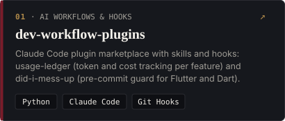
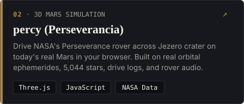
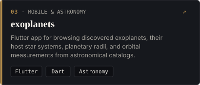
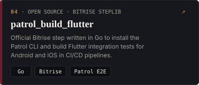
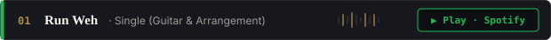
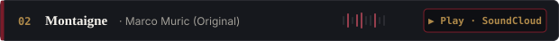
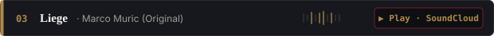
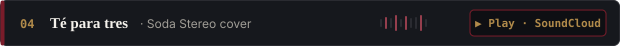
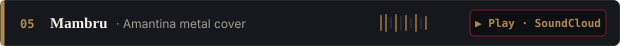

  <!-- Local Animated Wave Header matching muric.dev palette (#0E0F13 · #7A1C2A · #B08A4A) -->
  

  <!-- Animated Typing SVG (readme-typing-svg) -->
  

  

    
    
    
    
    
  

<!-- SIDE A // 01 · LINER NOTES -->

  

  Hi! I’m <b>Marco</b> (<code>@muric-dev</code>), from <b>Mexico 🇲🇽</b>, now living in <b>France 🇫🇷</b> and switching between Spanish, English, and French. 
  I’m curious by nature, so besides <b>Flutter and Dart</b> I work with <b>Python, Bash, Go, n8n, and AI agents</b>. 
  When I have time, I sneak off to a jam session or record as <b>Marco Muric</b>, mixing jazz fusion, Latin, and rock.

<!-- SIDE A // 02 · IN THE LAB -->

  

  

    
    &nbsp;
    
  

  

    
    &nbsp;
    
  

<!-- SIDE A // 03 · PEDALBOARD -->

  
   
  

 

<!-- SIDE B // 01 · MARCO MURIC -->

  

  

    
  

  

     
     
     
     
    
  

<!-- SIDE B // 02 · TELEMETRY -->

  
   
  
  

  

